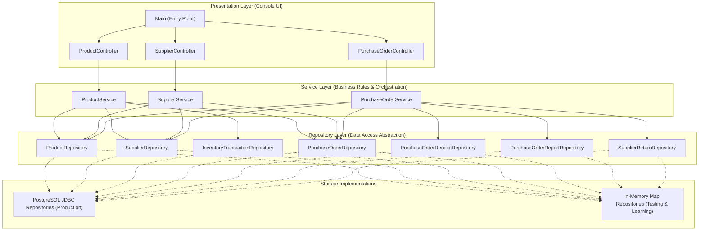

# StockFlow — Inventory & Warehouse Management System

[](https://www.oracle.com/java/)
[](https://gradle.org/)
[](https://www.postgresql.org/)
[](https://junit.org/junit5/)
[](docs/RELEASE_CHECKLIST.md)

StockFlow is a production-grade, console-based Inventory and Warehouse Management System built from the ground up in **Java 21** using **PostgreSQL**, raw **JDBC**, and **Gradle**.

Designed without opaque frameworks, StockFlow demonstrates clean Object-Oriented Programming (OOP), layered software architecture, deterministic concurrency control, immutable audit trails, and strict transactional data integrity.

---

## 📋 Table of Contents

- [Features Implemented](#-features-implemented)
- [Technology Stack](#-technology-stack)
- [System Requirements](#-system-requirements)
- [Project Directory Structure](#-project-directory-structure)
- [Layered Architecture](#-layered-architecture)
- [Quick Start Guide](#-quick-start-guide)
  - [1. Database Setup](#1-database-setup)
  - [2. Configuration](#2-configuration)
  - [3. Build and Run](#3-build-and-run)
  - [4. Running Tests](#4-running-tests)
- [Main Console Menus](#-main-console-menus)
- [Core Business Invariants](#-core-business-invariants)
- [Detailed Documentation](#-detailed-documentation)
- [Release Version](#-release-version)

---

## ✨ Features Implemented

StockFlow v1.0 delivers a complete, end-to-end warehouse and purchasing workflow:

1. **Product Management (CRUD & Validation):**
   - Create, list, find by SKU, search by name, update, and delete products.
   - Guarded invariants: immutable SKU identity, single-assignment ID, non-negative quantities and prices.
   - Case-insensitive partial name search and multi-field sorting (SKU, Name, Price, Quantity) with pagination.
2. **Stock Movements & Audit Trails:**
   - Atomic **Stock In** (receiving manual inventory) and **Stock Out** (sales, adjustments).
   - Real-time `inventory_transactions` audit log recording transaction type, timestamp, quantity, and product reference.
   - Invariant guard: Stock Out operations never produce negative inventory.
3. **Inventory Analytics & Reports:**
   - **Low-Stock Alert Report:** Highlights products falling below minimum safety stock levels.
   - **Inventory Summary Report:** Calculates total products, total stock units, low-stock count, and out-of-stock count.
   - **Inventory Valuation Report:** Line-by-line financial valuation and aggregate portfolio value.
4. **Supplier Management:**
   - Create, search, list, update, and delete suppliers with unique supplier codes, contact details, email, and phone.
   - Assign/reassign suppliers to products with foreign key validation and referential deletion protection.
5. **Purchase Order Lifecycle:**
   - Create draft purchase orders with customizable order numbers.
   - Add, update, or remove order line items with agreed purchasing unit costs independent of selling prices.
   - Formal order placement (`DRAFT` $\to$ `PLACED`) and cancellation rules.
6. **Delivery Receiving & Stock Integration:**
   - Full and partial delivery receipts linked directly to purchase order line items.
   - Automatic atomic stock increase and `STOCK_IN` audit record creation.
   - Auto-transition of order statuses (`PARTIALLY_RECEIVED` $\to$ `RECEIVED`).
   - Over-receiving protection: Received quantity cannot exceed remaining ordered capacity.
7. **Supplier Returns & Damaged Goods:**
   - Return damaged or defective items referencing specific delivery receipt lines (`purchase_order_receipt_items`).
   - Dynamic return capacity validation: $\text{Returnable} = \text{Received} - \text{Prior Returns}$.
   - Available on-hand warehouse stock check: Rejects returns if available stock is insufficient.
   - Automatic atomic stock deduction and linked `STOCK_OUT` audit transaction creation.
8. **Purchasing & Fulfillment Reports:**
   - **Outstanding Purchase Orders Report:** Tracks pending deliveries and fulfillment percentages.
   - **Receiving History Report:** Audits all deliveries received within a date range.
   - **Supplier Purchasing Summary:** Aggregates order count, ordered units, received units, and monetary commitments per supplier.
9. **Reliability, Concurrency & Data Integrity:**
   - Row-level locking (`SELECT ... FOR UPDATE`) in deterministic ascending ID order to eliminate circular-wait deadlocks.
   - Atomic multi-table JDBC transactions with automatic rollback on failure.
   - Defensive PostgreSQL CHECK constraints, 1-to-1 audit uniqueness, and foreign key indexes.

---

## 🛠️ Technology Stack

- **Programming Language:** Java 21 (GraalVM JDK 21 / Eclipse Adoptium OpenJDK 21)
- **Build Tool:** Gradle 9.3.0 (Groovy DSL)
- **Database:** PostgreSQL 14+ (compatible with 14, 15, 16, 17, 18)
- **Database Driver:** PostgreSQL JDBC Driver (`org.postgresql:postgresql:42.7.13`)
- **Testing Framework:** JUnit 5 (`org.junit.jupiter:junit-jupiter:5.10.2`)
- **User Interface:** Interactive terminal/console interface (CLI)
- **Architecture:** Layered Model-View-Controller (Controller $\to$ Service $\to$ Repository)

---

## 💻 System Requirements

- **Java Development Kit (JDK):** Version 21 or higher installed and configured (`JAVA_HOME`).
- **PostgreSQL Database:** PostgreSQL Server 14 or higher running locally or remotely on port 5432.
- **Operating System:** Windows, macOS, or Linux.
- **Build Tool:** Included Gradle Wrapper (`gradlew` / `gradlew.bat`); no separate Gradle installation required.

---

## 📁 Project Directory Structure

```
StockFlow/
├── build.gradle                              # Gradle build configuration
├── settings.gradle                           # Gradle project settings
├── gradlew / gradlew.bat                     # Gradle wrapper scripts
├── db.properties.example                     # Sample database configuration
├── schema.sql                                # Baseline DDL (Products & Transactions)
├── docs/                                     # Comprehensive Release Documentation
│   ├── DATABASE_SETUP.md                     # Step-by-step PostgreSQL setup & migration guide
│   ├── USER_GUIDE.md                         # Detailed console walkthroughs with examples
│   ├── ARCHITECTURE.md                       # Deep architectural & transactional design
│   ├── TESTING.md                            # Testing guide, test isolation, and troubleshooting
│   └── RELEASE_CHECKLIST.md                  # Release verification checklist
└── src/
    ├── main/
    │   ├── java/com/stockflow/
    │   │   ├── Main.java                     # Application bootstrap & Main Menu loop
    │   │   ├── controller/                   # Console UI controllers (Product, Supplier, PO)
    │   │   ├── database/                     # DatabaseConnection manager
    │   │   ├── exception/                    # ValidationException & DatabaseException
    │   │   ├── model/                        # Domain entities & immutable records
    │   │   ├── repository/                   # Repository interfaces, JDBC & In-Memory implementations
    │   │   └── service/                      # Business logic, orchestration, and validations
    │   └── resources/                        # Incremental Database Migrations
    │       ├── suppliers_schema.sql
    │       ├── schema_phase12_connect_suppliers.sql
    │       ├── schema_phase13a_purchase_orders.sql
    │       ├── schema_phase13b_receiving.sql
    │       ├── schema_phase15_supplier_returns.sql
    │       └── schema_phase16_integrity.sql
    └── test/java/com/stockflow/              # Comprehensive JUnit 5 Test Suites (548 tests)
        ├── controller/                       # Controller console simulation tests
        ├── database/                         # Connection tests
        ├── model/                            # Domain invariant & entity unit tests
        ├── reliability/                      # Concurrency, atomicity, invariant & E2E tests
        ├── repository/                       # JDBC & In-Memory repository tests
        └── service/                          # Service business logic & reporting tests
```

---

## 🏗️ Layered Architecture

StockFlow strictly follows the **Single Responsibility Principle** and **Dependency Inversion Principle**:



- **Separation of Concerns:** Controllers handle console I/O only. Services enforce business rules. Repositories manage database interaction.
- **Dual Storage Implementations:** Every repository defines an interface with two implementations:
  1. `Jdbc*Repository`: Native JDBC with explicit transaction boundaries and row-level locking.
  2. `InMemory*Repository`: Concurrent In-Memory maps for fast unit tests without external databases.

---

## 🚀 Quick Start Guide

### 1. Database Setup

1. Open your PostgreSQL terminal (`psql`) and create the database:
   ```sql
   CREATE DATABASE stockflow_db;
   ```
2. Execute the database migration scripts in order:
   ```bash
   psql -U postgres -d stockflow_db -f schema.sql
   psql -U postgres -d stockflow_db -f src/main/resources/suppliers_schema.sql
   psql -U postgres -d stockflow_db -f src/main/resources/schema_phase12_connect_suppliers.sql
   psql -U postgres -d stockflow_db -f src/main/resources/schema_phase13a_purchase_orders.sql
   psql -U postgres -d stockflow_db -f src/main/resources/schema_phase13b_receiving.sql
   psql -U postgres -d stockflow_db -f src/main/resources/schema_phase15_supplier_returns.sql
   psql -U postgres -d stockflow_db -f src/main/resources/schema_phase16_integrity.sql
   ```
   *(For full setup instructions and automated verification, see [DATABASE_SETUP.md](docs/DATABASE_SETUP.md)).*

### 2. Configuration

Create your local database configuration file from the example template:

```bash
# Windows (PowerShell)
Copy-Item db.properties.example db.properties

# Linux / macOS
cp db.properties.example db.properties
```

Edit `db.properties` with your PostgreSQL credentials:
```properties
db.url=jdbc:postgresql://localhost:5432/stockflow_db
db.user=postgres
db.password=your_secret_password
```

> [!NOTE]
> StockFlow also supports environment variables (`STOCKFLOW_DB_URL`, `STOCKFLOW_DB_USER`, `STOCKFLOW_DB_PASSWORD`) and Java system properties (`-Ddb.url=...`), ideal for Docker and CI/CD pipelines.

### 3. Build and Run

To launch the interactive console application:

```bash
# Windows
.\gradlew.bat run

# Linux / macOS
./gradlew run
```

### 4. Running Tests

Run the complete 548-test verification suite:

```bash
# Windows
.\gradlew.bat clean test

# Linux / macOS
./gradlew clean test
```
Test reports are automatically generated at `build/reports/tests/test/index.html`.

---

## 🖥️ Main Console Menus

Upon running StockFlow, you are presented with the top-level Main Menu:

```
============================================
   Welcome to StockFlow Management System   
============================================

=== Main Menu ===
1. Product Management
2. Supplier Management
3. Purchase Order Management
4. Exit
```

- **1. Product Management:** Add products, update details, stock in/out, view low-stock alerts, generate inventory summary and valuation reports, search by name, sort, paginate, and assign suppliers.
- **2. Supplier Management:** Add suppliers, view supplier details, list all suppliers, update contact details, and delete suppliers with safety guards.
- **3. Purchase Order Management:** Create draft purchase orders, add/update/remove line items, place orders, cancel draft orders, receive full or partial goods, view delivery receipts, access **Supplier Returns**, and run **Purchasing Reports**.

---

## 🛡️ Core Business Invariants

StockFlow enforces strict inventory and accounting rules across every layer:

1. **Identifier Uniqueness:** Product SKUs and Supplier Codes are immutable, unique, and strictly checked.
2. **Non-Negative Inventory:** Product quantities and prices can never drop below zero. Enforced both at the domain layer and via PostgreSQL `CHECK (quantity >= 0)`.
3. **Price Independence:** Product selling prices (`products.price`) and agreed purchasing unit costs (`purchase_order_items.unit_cost`) remain strictly independent. Updating a product's price does not alter historical purchase order costs.
4. **Controlled Stock Movements:** Product stock changes *only* through formal operations: Stock In, Stock Out, Purchase Order Receiving, or Supplier Returns.
5. **No Phantom Pre-Allocation:** Creating or placing a purchase order does *not* alter on-hand product stock until goods are physically received.
6. **No Over-Receiving:** Receiving quantities are bounded: $\text{Quantity} \le (\text{Ordered} - \text{Previously Received})$.
7. **Bounded Returns:** Return quantities cannot exceed originally received quantities minus prior returns.
8. **Stock Sufficiency on Returns:** A return is rejected if available on-hand stock is lower than the requested return quantity, preventing negative stock.
9. **Deletion Protections:** Products and suppliers referenced by active purchase orders, delivery receipts, returns, or audit transactions cannot be deleted (`ON DELETE RESTRICT`).
10. **Deadlock Immunity:** Multi-item receiving and return operations acquire row locks in deterministic ascending primary key order, preventing circular-wait deadlocks.

---

## 📚 Detailed Documentation

For in-depth guides and developer documentation, explore the `docs/` directory:

- 📖 **[Database Setup & Migration Guide](docs/DATABASE_SETUP.md):** Complete PostgreSQL installation, DDL execution order, backup advice, and troubleshooting.
- 🧑‍💻 **[Application User Guide](docs/USER_GUIDE.md):** Step-by-step walkthrough of all 10 core workflows with sample inputs and console outputs.
- 🏛️ **[Architecture & Design Documentation](docs/ARCHITECTURE.md):** Detailed breakdown of domain models, design patterns, transaction boundaries, and concurrency strategies.
- 🧪 **[Testing Guide](docs/TESTING.md):** How to run unit vs. integration tests, test isolation strategies, and CI/CD test configuration.
- ✅ **[v1.0 Release Checklist](docs/RELEASE_CHECKLIST.md):** Verification log validating all release requirements.

---

## 🏷️ Release Version

- **Current Version:** **v1.0.0**
- **Release Date:** October 2026
- **Test Suite Status:** 548 / 548 passing (100% success rate)
- **Status:** Production-Ready Core Warehouse Management System
