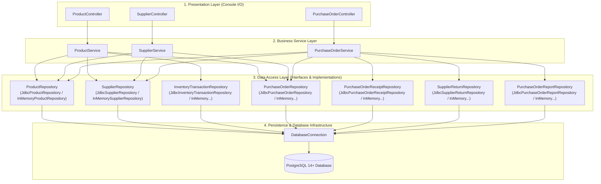
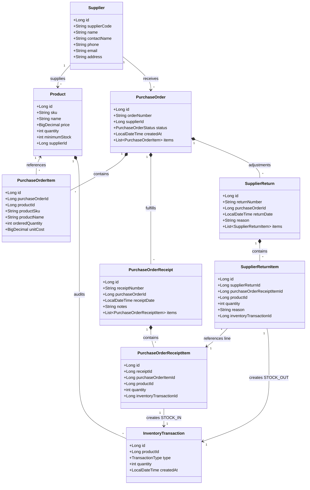
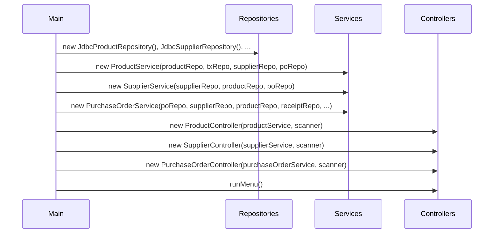
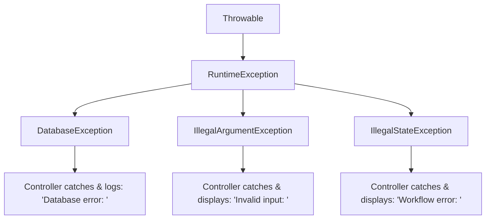

# StockFlow — System Architecture & Design Specification

This document provides a comprehensive architectural and design overview of **StockFlow v1.0**, detailing its layered patterns, domain models, transaction boundaries, concurrency safeguards, dependency injection strategy, and error handling mechanisms.

---

## 1. Architectural Style & Design Principles

StockFlow is designed as a modular, beginner-accessible, yet enterprise-grade monolithic application. It strictly adheres to:

1. **Separation of Concerns (SoC)**: Presentation, business domain rules, and data access reside in completely separate layers.
2. **Explicit Constructor-Based Dependency Injection (DI)**: No runtime reflection, Spring annotations, or magic proxies. All dependencies are wired transparently in [`Main.java`](file:///d:/My%20Own%20Project/StockFlow/src/main/java/com/stockflow/Main.java).
3. **Repository Pattern with Dual Implementations**: Every repository defines an interface and provides both a production-ready PostgreSQL JDBC implementation and an in-memory test implementation.
4. **ACID Transaction Boundaries**: Multi-table operations (such as receiving purchase orders and processing supplier returns) run under explicit atomic database transactions with rollback on failure.
5. **Defensive Deadlock Prevention**: Row-level locking (`SELECT ... FOR UPDATE`) is acquired in deterministic ascending primary key order.

---

## 2. Layered Architecture



### Presentation Layer
- **Responsibility**: Manages terminal input/output, prompts the user, formats tabular data, catches domain/database exceptions, and presents understandable error messages without crashing the loop.
- **Components**: `ProductController`, `SupplierController`, `PurchaseOrderController`.

### Service Layer
- **Responsibility**: Enforces all business logic, workflow state transitions, inventory invariants (non-negative stock, unique SKUs), transaction orchestrations, and referential validation.
- **Components**: `ProductService`, `SupplierService`, `PurchaseOrderService`.

### Repository Layer
- **Responsibility**: Abstract persistence operations behind pure Java interfaces. Encapsulates SQL queries, `PreparedStatement` parameter binding, `ResultSet` object mapping, and in-memory test mocks.
- **Dual Implementations**:
  - `Jdbc*Repository`: Issues optimized SQL statements to PostgreSQL via standard JDBC.
  - `InMemory*Repository`: Uses concurrent Java collections (`ConcurrentHashMap`, `CopyOnWriteArrayList`, atomic sequences) for fast unit testing without needing a running database instance.

### Infrastructure Layer
- **Responsibility**: Manages JDBC connections, connection property resolution (System Properties &rarr; Environment Variables &rarr; `db.properties`), and credential validation.
- **Component**: [`DatabaseConnection.java`](file:///d:/My%20Own%20Project/StockFlow/src/main/java/com/stockflow/database/DatabaseConnection.java).

---

## 3. Domain Model Architecture



---

## 4. Transaction Management & Concurrency Safety

StockFlow does not rely on third-party transaction managers. Instead, it utilizes raw JDBC transactional semantics to guarantee ACID compliance:

### 4.1 Explicit Atomic Transaction Pattern

```java
try (Connection conn = DatabaseConnection.getConnection()) {
    conn.setAutoCommit(false); // Begin atomic transaction
    try {
        // 1. Validate domain invariants & state
        // 2. Lock rows defensively
        // 3. Update stock levels
        // 4. Insert receipt/return master & items
        // 5. Insert audit inventory transaction
        
        conn.commit(); // Commit all operations atomically
    } catch (Exception e) {
        conn.rollback(); // Rollback completely on any failure
        throw e;
    } finally {
        conn.setAutoCommit(true);
    }
}
```

### 4.2 Deadlock Prevention via Ascending Row Locking

When multiple concurrent transactions attempt to lock the same set of products in different order, a database deadlock occurs. StockFlow eliminates deadlocks mathematically:

> [!IMPORTANT]
> Whenever multiple product rows must be locked via `SELECT ... FOR UPDATE`, StockFlow sorts the target product IDs in **ascending numeric order** before acquiring locks. Because all concurrent threads request row locks in the exact same sequence ($P_1 < P_2 < P_3$), circular wait conditions are impossible.

```java
// Anti-deadlock ordering in JdbcPurchaseOrderRepository:
List<PurchaseOrderItem> sortedItems = items.stream()
    .sorted(Comparator.comparingLong(PurchaseOrderItem::getProductId))
    .toList();

for (PurchaseOrderItem item : sortedItems) {
    // Acquire row locks strictly in ascending ID order
    lockProductRow(conn, item.getProductId());
}
```

### 4.3 1-to-1 Audit Constraint Integrity

In Phase 16, relational schema hardening introduced database-level unique constraints on audit foreign keys:
- `uk_po_receipt_item_tx`: Guarantees every PO receipt item maps to exactly **one** unique `inventory_transactions` record.
- `uk_supplier_return_item_tx`: Guarantees every supplier return item maps to exactly **one** unique `inventory_transactions` record.

This prevents race conditions or faulty code from sharing, reusing, or duplicating audit records.

---

## 5. Dependency Injection Architecture

StockFlow uses **pure constructor injection**. In [`Main.java`](file:///d:/My%20Own%20Project/StockFlow/src/main/java/com/stockflow/Main.java), the application composition root constructs dependencies from the inside out:



### Benefits of this Approach:
1. **Zero Framework Overhead**: Startup time is instantaneous with no classpath reflection or annotation processing.
2. **Deterministic Lifetime**: Every object is explicitly created and tracked.
3. **Unit Testing Speed**: Services can be tested with in-memory repository implementations in milliseconds without requiring mocks, Spring Boot Test, or Docker containers.

---

## 6. Exception Handling Strategy

StockFlow differentiates between system/database infrastructure failures and client/domain validation errors:



1. **`DatabaseException`**: Unchecked runtime exception wrapping low-level `SQLException`. Preserves the original `SQLException` cause while insulating upper layers from JDBC specifics.
2. **`IllegalArgumentException`**: Thrown when user inputs fail format, range, or nullness validation (e.g., negative prices, blank SKUs).
3. **`IllegalStateException`**: Thrown when business invariants or lifecycle states are violated (e.g., receiving an order in `DRAFT` status, deleting a supplier with linked products).
4. **Resilient Controller Loops**: The console controller catches domain and database exceptions, prints friendly human-readable alerts, and returns cleanly to the menu without crashing the process.
