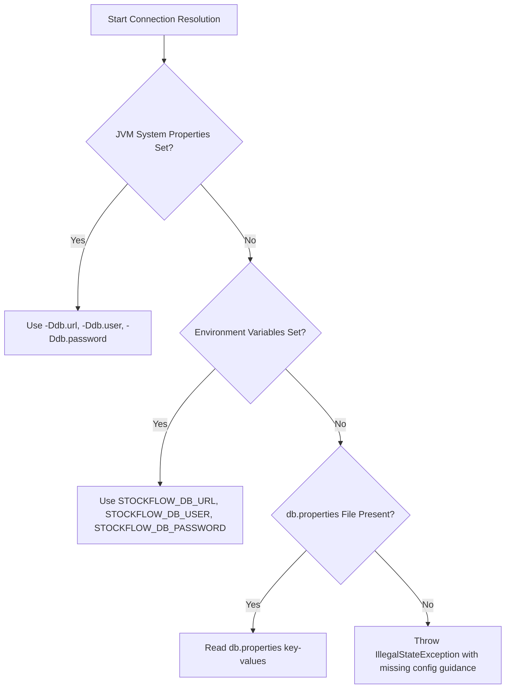

# StockFlow — Database Setup & Administration Guide

This guide provides complete instructions for setting up, configuring, migrating, backing up, and troubleshooting the PostgreSQL database for **StockFlow v1.0**.

---

## 1. System Requirements & Prerequisites

- **RDBMS**: PostgreSQL 14.0 or newer (PostgreSQL 15+ or 16+ recommended)
- **Client Tools**: `psql` command-line utility, or a graphical management client (e.g., pgAdmin 4, DBeaver, DataGrip)
- **Network**: Local or remote TCP connection to PostgreSQL (default port `5432`)
- **Permissions**: PostgreSQL user with permissions to create databases and execute DDL/DML statements (`CREATE`, `ALTER`, `DROP`, `SELECT`, `INSERT`, `UPDATE`, `DELETE`)

---

## 2. Database Creation

Open your terminal or PowerShell console and connect to your PostgreSQL instance as an administrative user (default: `postgres`):

### Using psql (Command Line)

```bash
# Connect and create database
psql -U postgres -h localhost -p 5432 -c "CREATE DATABASE stockflow_db;"
```

On Windows PowerShell:
```powershell
psql -U postgres -c "CREATE DATABASE stockflow_db;"
```

### Using GUI (pgAdmin 4 / DBeaver)
1. Connect to your PostgreSQL server.
2. Right-click **Databases** &rarr; **Create** &rarr; **Database...**
3. Set **Database Name** to `stockflow_db`.
4. Ensure Owner is `postgres` (or your application user) and Encoding is `UTF8`.
5. Click **Save**.

---

## 3. Schema Migrations (Strict Execution Order)

StockFlow manages its relational schema through modular, numbered SQL migration scripts. 

> [!IMPORTANT]
> The scripts **must** be executed in the exact sequential order listed below. Each subsequent migration script depends on tables, columns, and foreign key constraints established by previous scripts.

| Step | Script Path | Description & Schema Artifacts |
|---|---|---|
| **1** | [`schema.sql`](file:///d:/My%20Own%20Project/StockFlow/schema.sql) | Baseline schema creating `products` table (unique `sku`, pricing, stock) and `inventory_transactions` audit ledger (`product_id`, `type`, `quantity`, `created_at`). |
| **2** | [`src/main/resources/suppliers_schema.sql`](file:///d:/My%20Own%20Project/StockFlow/src/main/resources/suppliers_schema.sql) | Creates `suppliers` table (`supplier_code` UNIQUE, `name`, `contact_name`, `phone`, `email`, `address`). |
| **3** | [`src/main/resources/schema_phase12_connect_suppliers.sql`](file:///d:/My%20Own%20Project/StockFlow/src/main/resources/schema_phase12_connect_suppliers.sql) | Alters `products` table to append `supplier_id BIGINT REFERENCES suppliers(id) ON DELETE RESTRICT`. |
| **4** | [`src/main/resources/schema_phase13a_purchase_orders.sql`](file:///d:/My%20Own%20Project/StockFlow/src/main/resources/schema_phase13a_purchase_orders.sql) | Creates `purchase_orders` (`order_number` UNIQUE, `supplier_id`, `status`) and `purchase_order_items` (composite unique `[purchase_order_id, product_id]`, ordered quantity, unit cost). |
| **5** | [`src/main/resources/schema_phase13b_receiving.sql`](file:///d:/My%20Own%20Project/StockFlow/src/main/resources/schema_phase13b_receiving.sql) | Creates `purchase_order_receipts` (`receipt_number` UNIQUE, `purchase_order_id`) and `purchase_order_receipt_items` linking received lines to `inventory_transactions.id`. |
| **6** | [`src/main/resources/schema_phase15_supplier_returns.sql`](file:///d:/My%20Own%20Project/StockFlow/src/main/resources/schema_phase15_supplier_returns.sql) | Creates `supplier_returns` (`return_number` UNIQUE, `purchase_order_id`) and `supplier_return_items` linking return movements to `purchase_order_receipt_item_id` and audit transaction records. |
| **7** | [`src/main/resources/schema_phase16_integrity.sql`](file:///d:/My%20Own%20Project/StockFlow/src/main/resources/schema_phase16_integrity.sql) | Defensive `CHECK` constraints on `products` (`quantity >= 0`, `minimum_stock >= 0`, `price >= 0`), 1-to-1 `UNIQUE` audit transaction constraints, and B-Tree indexes on all foreign key columns. |

### Running Migrations via psql (Windows PowerShell)

Run the following commands from the project root directory:

```powershell
# 1. Base products and inventory transaction ledger
psql -U postgres -d stockflow_db -f schema.sql

# 2. Suppliers master table
psql -U postgres -d stockflow_db -f src/main/resources/suppliers_schema.sql

# 3. Product-to-Supplier relationship
psql -U postgres -d stockflow_db -f src/main/resources/schema_phase12_connect_suppliers.sql

# 4. Purchase orders & items
psql -U postgres -d stockflow_db -f src/main/resources/schema_phase13a_purchase_orders.sql

# 5. PO receipts & stock receipt items
psql -U postgres -d stockflow_db -f src/main/resources/schema_phase13b_receiving.sql

# 6. Supplier returns & damage tracking
psql -U postgres -d stockflow_db -f src/main/resources/schema_phase15_supplier_returns.sql

# 7. Final integrity constraints and performance indexes
psql -U postgres -d stockflow_db -f src/main/resources/schema_phase16_integrity.sql
```

### Running Migrations via psql (Linux / macOS Bash)

```bash
psql -U postgres -d stockflow_db -f schema.sql
psql -U postgres -d stockflow_db -f src/main/resources/suppliers_schema.sql
psql -U postgres -d stockflow_db -f src/main/resources/schema_phase12_connect_suppliers.sql
psql -U postgres -d stockflow_db -f src/main/resources/schema_phase13a_purchase_orders.sql
psql -U postgres -d stockflow_db -f src/main/resources/schema_phase13b_receiving.sql
psql -U postgres -d stockflow_db -f src/main/resources/schema_phase15_supplier_returns.sql
psql -U postgres -d stockflow_db -f src/main/resources/schema_phase16_integrity.sql
```

---

## 4. Application Configuration

StockFlow's [`DatabaseConnection`](file:///d:/My%20Own%20Project/StockFlow/src/main/java/com/stockflow/database/DatabaseConnection.java) class evaluates database connection parameters using a 3-tier precedence hierarchy:



### Option A: `db.properties` Configuration (Standard for Local Development)

Copy the provided template [`db.properties.example`](file:///d:/My%20Own%20Project/StockFlow/db.properties.example) to `db.properties` in the project root:

```powershell
Copy-Item db.properties.example db.properties
```

Edit `db.properties` to specify your PostgreSQL credentials:

```properties
db.url=jdbc:postgresql://localhost:5432/stockflow_db
db.user=postgres
db.password=your_secure_password
```

> [!CAUTION]
> Never commit `db.properties` to source control. The repository `.gitignore` is pre-configured to exclude `db.properties` to protect confidential credentials.

### Option B: Environment Variables (Recommended for Production & Docker)

Set the following environment variables in your environment:

- **Windows PowerShell**:
  ```powershell
  $env:STOCKFLOW_DB_URL="jdbc:postgresql://localhost:5432/stockflow_db"
  $env:STOCKFLOW_DB_USER="postgres"
  $env:STOCKFLOW_DB_PASSWORD="your_secure_password"
  ```
- **Linux / macOS**:
  ```bash
  export STOCKFLOW_DB_URL="jdbc:postgresql://localhost:5432/stockflow_db"
  export STOCKFLOW_DB_USER="postgres"
  export STOCKFLOW_DB_PASSWORD="your_secure_password"
  ```

### Option C: JVM System Properties (Ideal for Testing & CI/CD)

Pass JVM properties directly to the Gradle execution command:

```powershell
.\gradlew.bat test -Ddb.url=jdbc:postgresql://localhost:5432/stockflow_db -Ddb.user=postgres -Ddb.password=your_secure_password
```

---

## 5. Verifying Database Connection

To verify that your database credentials and schema are configured properly:

1. **Run the integration test suite**:
   ```powershell
   .\gradlew.bat test --tests "*Jdbc*"
   ```
2. **Launch the application**:
   ```powershell
   .\gradlew.bat run
   ```
   If configured properly, the welcome banner will display and present the StockFlow Main Menu.

---

## 6. Backup and Restore Procedures

### Backing Up the Database

To create a full relational backup (schema + data) using `pg_dump`:

```powershell
# Plain SQL dump (human readable)
pg_dump -U postgres -h localhost -d stockflow_db -F p -f "stockflow_backup_$(Get-Date -Format 'yyyyMMdd_HHmmss').sql"

# Custom binary dump (compressed, faster restore)
pg_dump -U postgres -h localhost -d stockflow_db -F c -f "stockflow_backup_$(Get-Date -Format 'yyyyMMdd_HHmmss').dump"
```

### Restoring from Backup

```powershell
# Restore from plain SQL dump
psql -U postgres -h localhost -d stockflow_db -f stockflow_backup_20261021.sql

# Restore from custom binary dump
pg_restore -U postgres -h localhost -d stockflow_db -c stockflow_backup_20261021.dump
```

---

## 7. Troubleshooting & FAQ

### Issue: `FATAL: password authentication failed for user "postgres"`
- **Cause**: The password specified in `db.properties` or `STOCKFLOW_DB_PASSWORD` does not match the PostgreSQL user account.
- **Resolution**: Verify credentials by connecting manually with `psql -U postgres -W`. Update `db.properties` with the correct password.

### Issue: `Connection refused: connect`
- **Cause**: The PostgreSQL service is stopped or listening on a different port or network interface.
- **Resolution**:
  - Windows: Open `services.msc` and verify that `postgresql-x64-<version>` is **Running**.
  - Linux: Run `sudo systemctl status postgresql` or `sudo systemctl restart postgresql`.
  - Check `postgresql.conf` to confirm `listen_addresses = 'localhost'` and `port = 5432`.

### Issue: `FATAL: database "stockflow_db" does not exist`
- **Cause**: The database was not created prior to launching the application.
- **Resolution**: Run `psql -U postgres -c "CREATE DATABASE stockflow_db;"`.

### Issue: `relation "suppliers" does not exist`
- **Cause**: Schema migration scripts were executed out of order or Step 2 was omitted.
- **Resolution**: Re-run the migration scripts in strict sequence starting from Step 1.

### Issue: `duplicate key value violates unique constraint "products_sku_key"`
- **Cause**: An attempt was made to insert or update a product with an SKU already assigned to another record.
- **Resolution**: SKUs must be unique across all products. Provide a distinct SKU.
