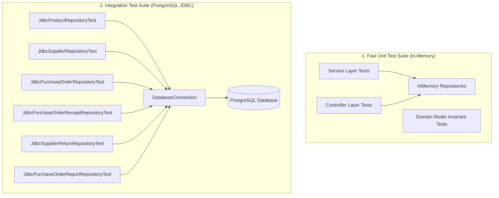

# StockFlow — Testing & Quality Assurance Guide

This document details the test architecture, test execution procedures, continuous integration practices, and test reporting for **StockFlow v1.0**.

---

## 1. Test Suite Overview & Metrics

StockFlow maintains a comprehensive, zero-defect test suite covering domain entities, business service logic, console user interaction controllers, and PostgreSQL JDBC data access operations.

| Metric | Status |
|---|---|
| **Total Test Count** | **548 tests** |
| **Pass Rate** | **100% (548 passed, 0 failures, 0 skipped)** |
| **Testing Framework** | JUnit Jupiter 5.10.2 via JUnit BOM |
| **Execution Time** | ~18 seconds (full clean test run) |
| **Dual Testing Strategy** | Unit tests (In-Memory) + Integration tests (PostgreSQL JDBC) |

---

## 2. Test Architecture: Dual Test Suites

StockFlow uses a dual-suite testing design that separates rapid business logic validation from database integration verification:



### In-Memory Unit Tests
- Execute in milliseconds without external infrastructure.
- Use `InMemory*Repository` implementations storing entities in `ConcurrentHashMap` and `CopyOnWriteArrayList`.
- Validate complex business workflows, validation boundaries, exception branches, and pagination math.

### PostgreSQL JDBC Integration Tests
- Run real SQL statements against live PostgreSQL tables.
- Validate foreign key constraints, `ON DELETE RESTRICT` rules, unique SKU/Supplier constraints, SQL sorting, and transaction rollbacks.

---

## 3. Running Tests

### Running the Complete Test Suite

From the project root:

```powershell
# Windows
.\gradlew.bat test

# Clean build and test execution
.\gradlew.bat clean test
```

On Linux or macOS:
```bash
./gradlew test
./gradlew clean test
```

### Running Specific Test Classes

You can target any individual test class using the `--tests` flag:

```powershell
# Run only ProductService unit tests
.\gradlew.bat test --tests "com.stockflow.service.ProductServiceTest"

# Run only PurchaseOrderService tests
.\gradlew.bat test --tests "com.stockflow.service.PurchaseOrderServiceTest"

# Run only SupplierController tests
.\gradlew.bat test --tests "com.stockflow.controller.SupplierControllerTest"
```

### Running Subsets (Unit vs Integration)

To run only the PostgreSQL JDBC integration suite:
```powershell
.\gradlew.bat test --tests "*Jdbc*"
```

To run only the service and controller unit tests:
```powershell
.\gradlew.bat test --tests "*ServiceTest" --tests "*ControllerTest"
```

---

## 4. Test Isolation & Data Cleanliness

StockFlow's integration tests follow strict test isolation principles to prevent test pollution, race conditions, or order-dependent test failures:

1. **Unique Key Generation**: Entities created during tests use dynamically generated unique identifiers (e.g., `UUID.randomUUID().toString().substring(0, 8)` or timestamps) for SKUs, supplier codes, order numbers, and receipt numbers.
2. **Deterministic Cleanup**: Integration test fixtures clean up their created records in `@AfterEach` or `@BeforeEach` teardown hooks in reverse dependency order (Return Items &rarr; Returns &rarr; Receipt Items &rarr; Receipts &rarr; PO Items &rarr; POs &rarr; Inventory Tx &rarr; Products &rarr; Suppliers).
3. **No Cross-Test Contamination**: Tests never rely on data seeded by a prior test method.

---

## 5. Configuring Test Database Credentials

When running integration tests in CI/CD environments (e.g., GitHub Actions, GitLab CI, Jenkins), you can inject database credentials using environment variables or JVM system properties without creating a `db.properties` file:

### Using Environment Variables
```bash
export STOCKFLOW_DB_URL="jdbc:postgresql://postgres-ci-host:5432/stockflow_test_db"
export STOCKFLOW_DB_USER="runner"
export STOCKFLOW_DB_PASSWORD="ci_secret_password"
./gradlew test
```

### Using JVM System Properties
```powershell
.\gradlew.bat test -Ddb.url=jdbc:postgresql://localhost:5432/stockflow_db -Ddb.user=postgres -Ddb.password=my_password
```

---

## 6. Accessing & Interpreting Test Reports

Gradle generates an HTML report upon test completion.

### Location of the Test Report:
- File path: `build/reports/tests/test/index.html`

### Opening the Report in Your Browser:
On Windows PowerShell:
```powershell
Start-Process "build\reports\tests\test\index.html"
```
On macOS:
```bash
open build/reports/tests/test/index.html
```
On Linux:
```bash
xdg-open build/reports/tests/test/index.html
```

### Report Contents
- **Summary**: Displays overall test duration, total test count (548), failure count (0), and success rate (100%).
- **Packages**: Breaks down metrics across `com.stockflow.model`, `com.stockflow.service`, `com.stockflow.controller`, and `com.stockflow.repository`.
- **Classes**: Details execution time and status for every individual test case. If an assertion fails, the report provides a full stack trace and diff comparison.
