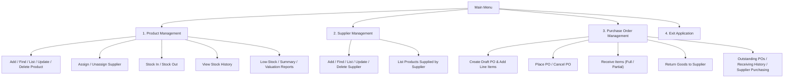
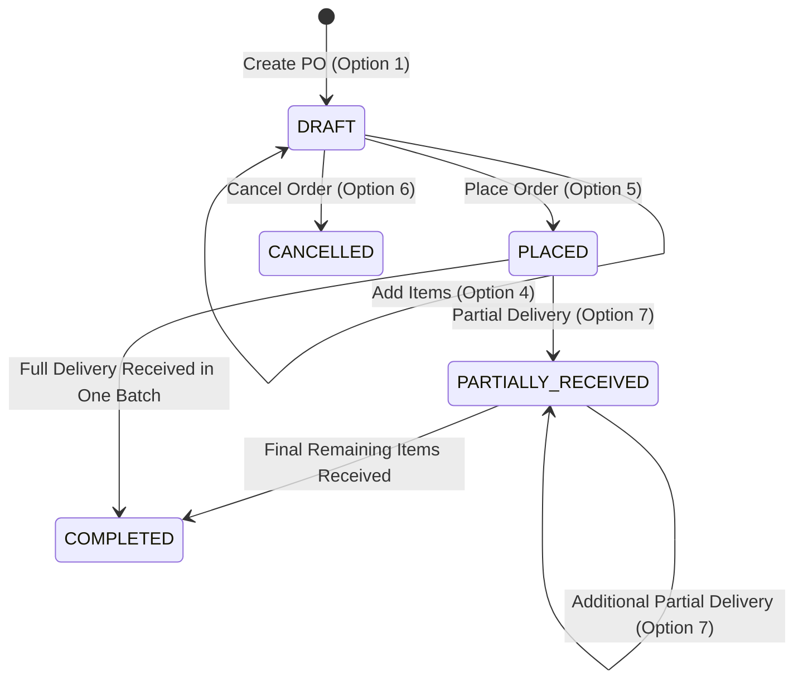

# StockFlow — User Guide & Operator Manual

Welcome to the **StockFlow v1.0** User Guide. This comprehensive guide walks you through every feature of the StockFlow console interface, complete with realistic sample sessions, navigation paths, menu commands, and operational best practices.

---

## Table of Contents
1. [Starting the Application](#1-starting-the-application)
2. [Main Navigation Structure](#2-main-navigation-structure)
3. [Workflow 1: Product Management](#3-workflow-1-product-management)
4. [Workflow 2: Supplier Management](#4-workflow-2-supplier-management)
5. [Workflow 3: Assigning & Changing Product Suppliers](#5-workflow-3-assigning--changing-product-suppliers)
6. [Workflow 4: Stock In & Stock Out Operations](#6-workflow-4-stock-in--stock-out-operations)
7. [Workflow 5: Inventory Reports & Valuation](#7-workflow-5-inventory-reports--valuation)
8. [Workflow 6: Purchase Order Management](#8-workflow-6-purchase-order-management)
9. [Workflow 7: Receiving Purchase Orders](#9-workflow-7-receiving-purchase-orders)
10. [Workflow 8: Receiving History & Audit Ledgers](#10-workflow-8-receiving-history--audit-ledgers)
11. [Workflow 9: Supplier Returns & Damaged Goods](#11-workflow-9-supplier-returns--damaged-goods)
12. [Workflow 10: Purchasing & Vendor Reports](#12-workflow-10-purchasing--vendor-reports)
13. [Input Validation & Error Messages](#13-input-validation--error-messages)

---

## 1. Starting the Application

To launch StockFlow, execute the following command in your terminal from the project root:

```powershell
.\gradlew.bat run
```

Or on Linux / macOS:
```bash
./gradlew run
```

Upon startup, you will see the StockFlow banner and Main Menu:

```text
================================================
   Welcome to StockFlow v1.0 Management System   
================================================

=== Main Menu ===
1. Product Management
2. Supplier Management
3. Purchase Order Management
4. Exit
Enter your choice: 
```

Type `1`, `2`, `3`, or `4` and press `Enter`.

---

## 2. Main Navigation Structure



---

## 3. Workflow 1: Product Management

From the Main Menu, choose `1` to enter **Product Management**.

```text
=== Product Management ===
1. Add Product
2. Find Product by ID
3. Find Product by SKU
4. Search Products by Name
5. List All Products (Paginated & Sorted)
6. Update Product
7. Delete Product
8. Assign Supplier to Product
9. Remove Supplier from Product
10. Stock In
11. Stock Out
12. View Product Stock History
13. Inventory Reports (Low Stock, Valuation, Summary)
14. Back to Main Menu
Enter your choice: 
```

### 3.1 Adding a New Product
Select `1`. You will be prompted for SKU, name, price, initial quantity, and minimum stock threshold:

```text
Enter SKU: ELEC-001
Enter Name: Ergonomic Mechanical Keyboard
Enter Price: 89.99
Enter Initial Quantity: 50
Enter Minimum Stock Threshold: 15

Product added successfully! (ID: 1)
```

### 3.2 Finding Products
- **Option 2 (By ID)**: Enter numeric ID (e.g., `1`). Returns product details including SKU, name, current stock, price, and assigned supplier.
- **Option 3 (By SKU)**: Enter exact SKU (e.g., `ELEC-001`).
- **Option 4 (Search by Name)**: Case-insensitive partial matching (e.g., `keyb` matches `Ergonomic Mechanical Keyboard`).

### 3.3 Listing Products (Sorting & Pagination)
Select `5`. You can specify page size, page number, and sort column:
```text
Enter page number (default 1): 1
Enter page size (default 10): 5
Sort by (id, sku, name, price, quantity) [default: id]: name
Sort order (asc, desc) [default: asc]: asc

Page 1 of 3 (Total items: 12)
---------------------------------------------------------------------------------------------------------
ID   | SKU         | Name                          | Price    | Stock | Min | Supplier
---------------------------------------------------------------------------------------------------------
1    | ELEC-001    | Ergonomic Mechanical Keyboard | $  89.99 | 50    | 15  | Global Logistics (SUP-001)
2    | ACC-002     | USB-C Fast Charging Cable     | $  14.50 | 120   | 30  | Global Logistics (SUP-001)
---------------------------------------------------------------------------------------------------------
```

### 3.4 Updating & Deleting Products
- **Option 6 (Update)**: Update name, price, or minimum stock threshold. Quantity is protected from manual edits and must be updated via Stock In, Stock Out, or PO Receiving.
- **Option 7 (Delete)**: Deleting a product checks referential integrity. If the product has purchase orders or receipt line history, deletion is blocked to maintain audit safety.

---

## 4. Workflow 2: Supplier Management

From the Main Menu, choose `2` to enter **Supplier Management**.

```text
=== Supplier Management ===
1. Add Supplier
2. Find Supplier by ID
3. Find Supplier by Code
4. List All Suppliers
5. Update Supplier
6. Delete Supplier
7. List Products for Supplier
8. Back to Main Menu
Enter your choice: 
```

### 4.1 Adding a Supplier
Select `1`:
```text
Enter Supplier Code: SUP-001
Enter Company Name: Acme Tech Supplies Ltd
Enter Contact Name: John Doe
Enter Phone: +1-555-0199
Enter Email: sales@acmetech.com
Enter Address: 742 Evergreen Terrace, Springfield

Supplier added successfully! (ID: 1)
```

### 4.2 Listing Products for a Supplier
Select `7` and enter Supplier ID `1`. Displays all products currently assigned to this vendor, their current inventory counts, and reorder levels.

### 4.3 Referential Integrity on Deletion
If you attempt to delete a supplier that is linked to active products or existing purchase orders, StockFlow displays a descriptive constraint error:
```text
Cannot delete supplier: Supplier ID 1 is assigned to 3 existing product(s) or purchase order(s). Unassign products or archive records before deleting.
```

---

## 5. Workflow 3: Assigning & Changing Product Suppliers

In Product Management:
- **Option 8 (Assign Supplier)**:
  ```text
  Enter Product ID: 1
  Enter Supplier ID: 2
  Supplier 'Apex Components' (SUP-002) successfully assigned to product 'Ergonomic Mechanical Keyboard' (ID: 1).
  ```
- **Option 9 (Remove Supplier)**:
  ```text
  Enter Product ID: 1
  Supplier assignment removed from product 'Ergonomic Mechanical Keyboard' (ID: 1).
  ```

---

## 6. Workflow 4: Stock In & Stock Out Operations

Stock movements are tracked in an immutable audit ledger (`inventory_transactions`).

### 6.1 Stock In (Restocking)
From Product Management, select `10`:
```text
Enter Product ID: 1
Enter Quantity to Add: 25

Successfully added 25 units. New quantity: 75.
Audit Transaction ID: 104 recorded (Type: STOCK_IN).
```

### 6.2 Stock Out (Order Dispatch or Loss)
From Product Management, select `11`:
```text
Enter Product ID: 1
Enter Quantity to Deduct: 10

Successfully deducted 10 units. New quantity: 65.
Audit Transaction ID: 105 recorded (Type: STOCK_OUT).
```

> [!WARNING]
> StockFlow strictly prohibits negative inventory. If you request a deduction greater than available stock:
> ```text
> Error: Insufficient stock. Current stock is 65, requested deduction is 100.
> ```

### 6.3 Viewing Stock History
Select `12` to view the full chronologically sorted audit log for any product:
```text
Enter Product ID: 1

Stock Audit History for Product #1 (Ergonomic Mechanical Keyboard):
-----------------------------------------------------------------------
Tx ID | Type       | Quantity | Timestamp
-----------------------------------------------------------------------
104   | STOCK_IN   | 25       | 2026-10-21 10:15:30
105   | STOCK_OUT  | 10       | 2026-10-21 11:42:15
-----------------------------------------------------------------------
```

---

## 7. Workflow 5: Inventory Reports & Valuation

From Product Management, select `13` to view the Inventory Reports submenu:

```text
=== Inventory Reports ===
1. Low-Stock Alerts Report
2. Inventory Summary Report
3. Inventory Valuation Report
4. Back to Product Menu
```

- **Low-Stock Alerts Report**: Filters products where `quantity <= minimum_stock`. Displays shortfall amount needed to reach safe threshold.
- **Inventory Summary**: Displays total catalog count, total items in stock, total out-of-stock items, and inventory health metrics.
- **Inventory Valuation**: Computes product-level and warehouse-wide total capital tied up in inventory (`quantity * price`).

---

## 8. Workflow 6: Purchase Order Management

From the Main Menu, choose `3` to enter **Purchase Order Management**:

```text
=== Purchase Order Management ===
1. Create Purchase Order (Draft)
2. View Purchase Order Details
3. List Purchase Orders
4. Add Item to Purchase Order
5. Place Purchase Order
6. Cancel Purchase Order
7. Receive Purchase Order Items
8. View PO Receiving History
9. Return Goods to Supplier
10. Purchasing Reports
11. Back to Main Menu
Enter your choice: 
```

### 8.1 PO Lifecycle State Machine



### 8.2 Creating a Purchase Order
1. Select `1`.
2. Enter Supplier ID (e.g., `1`).
3. System generates a unique order number (e.g., `PO-20261021-9843`) in status `DRAFT`.
4. Select `4` to add line items:
   ```text
   Enter PO ID: 1
   Enter Product ID: 2
   Enter Ordered Quantity: 50
   Enter Unit Cost: 12.00
   
   Item added to PO #1 successfully!
   ```
5. Select `5` to place the order:
   ```text
   Enter PO ID: 1
   Purchase Order PO-20261021-9843 placed successfully. Status is now PLACED.
   ```

---

## 9. Workflow 7: Receiving Purchase Orders

When physical shipments arrive from the supplier, select `7`:

```text
Enter Purchase Order ID: 1

PO #1 (PO-20261021-9843) Lines:
Line 1: Product #2 (USB-C Cable) | Ordered: 50 | Received: 0 | Remaining: 50 | Cost: $12.00

Enter receiving options:
1. Receive full order
2. Receive specific item lines
Enter choice: 2

Select PO Item ID: 1
Enter Quantity Received: 30
Enter Receiving Notes: Batch #992 received in good condition.

Receipt #REC-20261021-001 created.
Successfully received 30 units of Product #2. Product stock increased from 120 to 150.
PO Status updated to: PARTIALLY_RECEIVED.
```

---

## 10. Workflow 8: Receiving History & Audit Ledgers

Select `8` in Purchase Order Management to view receipts:

```text
Enter Purchase Order ID: 1

Receipts for PO #1 (PO-20261021-9843):
-----------------------------------------------------------------------
Receipt No: REC-20261021-001 | Date: 2026-10-21 14:10:00 | Notes: Batch #992
  - Line 1: Product #2 (USB-C Cable) | Qty Received: 30 | Stock Tx ID: 106
-----------------------------------------------------------------------
```

Every receipt line item is bound to an audit `STOCK_IN` transaction, ensuring full traceability from vendor invoice to warehouse shelf.

---

## 11. Workflow 9: Supplier Returns & Damaged Goods

If items delivered against a purchase order receipt are broken, incorrect, or defective, select `9` (**Return Goods to Supplier**):

```text
Enter Purchase Order ID: 1
Enter Receipt Item ID: 1
Available returnable quantity for this receipt line: 30
Enter Return Quantity: 5
Enter Reason for Return: Damaged casing upon inspection.

Return record #RET-20261021-001 created.
Deducted 5 units from Product #2 (Stock: 150 -> 145).
Audit Transaction ID: 107 recorded (Type: STOCK_OUT).
```

### Safety Rules Enforced by StockFlow
1. Returns must reference a valid receipt line item.
2. Total returned quantity across all return records cannot exceed the quantity received on that receipt line.
3. Returning goods automatically deducts warehouse stock and generates a permanent `STOCK_OUT` transaction.

---

## 12. Workflow 10: Purchasing & Vendor Reports

Select `10` from Purchase Order Management to access Purchasing Reports:

```text
=== Purchasing Reports ===
1. Outstanding Purchase Orders (PLACED or PARTIALLY_RECEIVED)
2. Receiving History Report (by PO or Supplier)
3. Supplier Purchasing Summary (Total Orders, Total Spend, Total Receipts)
4. Back to Purchase Order Menu
```

- **Outstanding Purchase Orders**: Shows pending vendor commitments, expected line items, and fulfillment progress percentages.
- **Receiving History Report**: Full chronological ledger of received shipments, unit costs, and receiving dates.
- **Supplier Purchasing Summary**: Aggregates total purchase orders placed, completed spend, open orders, and return rates per supplier.

---

## 13. Input Validation & Error Messages

StockFlow validates user input defensively at the console controller and service layers:

| Error Symptom | Cause | Solution |
|---|---|---|
| `Invalid input: Expected positive integer` | User typed text or negative number for quantity or ID | Enter a positive whole integer (e.g., `1`, `50`) |
| `Product with SKU '...' already exists` | Duplicate product SKU entered | Ensure SKU is unique before adding |
| `Insufficient stock` | Attempted Stock Out or Return exceeds on-hand quantity | Check available stock with Option 2 or Option 5 |
| `Cannot receive more than remaining ordered quantity` | Over-receiving entered during PO receipt | Enter an amount less than or equal to `Remaining` |
| `Total returned quantity cannot exceed received quantity` | Return quantity exceeds receipt line quantity | Verify receipt line quantity before initiating return |
